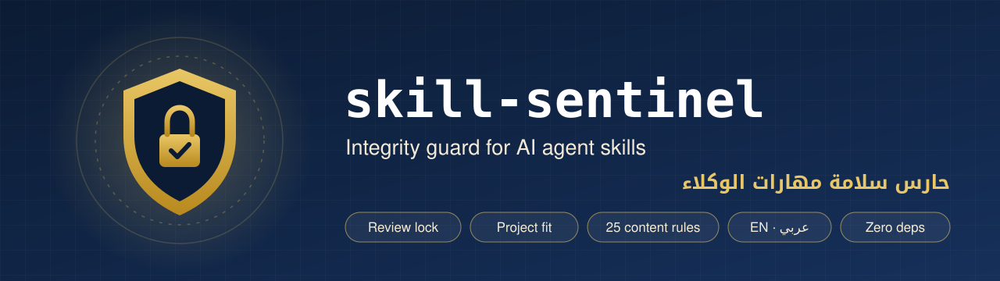
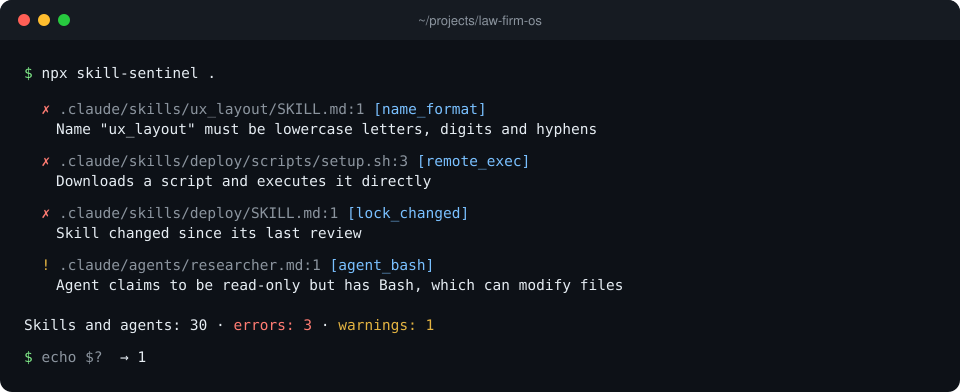
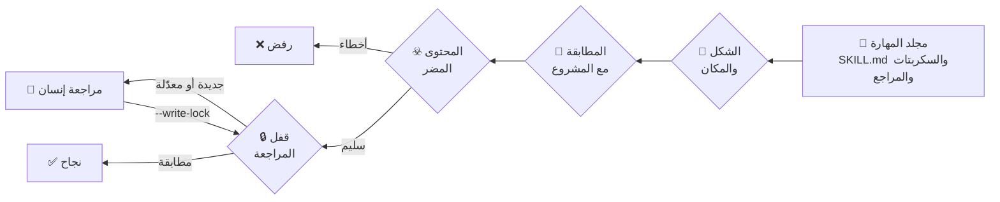

<p align="center">
  
</p>

<p align="center">
  <a href="https://github.com/C3MR/skill-sentinel/actions/workflows/ci.yml"></a>
  
  
  
  <a href="LICENSE"></a>
</p>

<div dir="rtl">

<p align="center">
  <b>افحص قبل التثبيت. اقفل بعد المراجعة. وامسك أي تغيير بعدها.</b>
</p>

<p align="center">
  <a href="https://c3mr.github.io/skill-sentinel/?lang=ar">الموقع</a> ·
  <a href="README.md">English</a> ·
  <a href="docs/rules.md">القواعد</a>
</p>

---

## 💡 لماذا

المهارة تعمل بكل صلاحيات الوكيل: الطرفية والملفات وبيانات الدخول. تثبيت مهارة يعني تثبيت تعليمات يطيعها وكيلك.

> وجدت Snyk **76** حمولة خبيثة مؤكدة لسرقة بيانات الدخول وتثبيت أبواب خلفية وتسريب البيانات، بين **3,984** مهارة عامة. و**13.4%** من كل المهارات فيها مشكلة حرجة واحدة على الأقل.
> — [Snyk](https://snyk.io/blog/toxicskills-malicious-ai-agent-skills-clawhub/)

> بين فبراير ومايو 2026 تجاوزت **خمس** مهارات خبيثة نسخاً محدّثة من فاحصَين، ولا يوجد فاحص واحد يكشف كل أنواع الهجوم.
> — [Cloud Security Alliance](https://labs.cloudsecurityalliance.org/research/csa-research-note-ai-agent-skill-scanner-bypass-20260629-csa/)

الفحص مرة قبل التثبيت ضروري لكنه لا يكفي. المهارة التي راجعتها الشهر الماضي قد تتغير في طلب الدمج القادم.

## 🛡️ ما الذي يميّزه

| | فاحص المهارات المعتاد | **skill-sentinel** |
| :-- | :--: | :--: |
| أنماط المحتوى المضر | ✅ | ✅ بالعربية **والإنجليزية** |
| يكشف المهارة التي تغيّرت *بعد* مراجعتها | ❌ | ✅ **قفل المراجعة** |
| يحدد **أي ملف** تغيّر منذ المراجعة | ❌ | ✅ |
| يفحص الخطافات والصلاحيات وخوادم MCP | نادراً | ✅ |
| يفحص حقول المهارة التي تعتمد أدوات مسبقاً أو تخفيها | نادراً | ✅ |
| يتأكد أن المهارة ما زالت تطابق المشروع | ❌ | ✅ |
| يرفض اعتماد مهارة فيها خطأ | — | ✅ |
| يفحص مهارة واحدة قبل تثبيتها | ✅ | ✅ |
| لغة التقارير | الإنجليزية | العربية · الإنجليزية |
| الاعتماديات | Python وYARA ونماذج لغوية… | **لا شيء** (Node 18+) |
| نسبة إنذار كاذب منشورة | نادراً | ✅ [مقاسة على 9,432 مهارة](docs/benchmark.md) |

صُمّم ليعمل **بجانب** الفاحصات الأعمق، لا بديلاً عنها.

## 🚀 البدء

</div>

```bash
# افحص مهارة قبل تثبيتها
npx skill-sentinel path/to/downloaded-skill --no-lock --lang ar

# افحص المشروع كاملاً
npx skill-sentinel . --lang ar

# بعد مراجعة كل المهارات: سجّل القفل واحفظه
npx skill-sentinel . --write-lock
git add skills.lock.json && git commit -m "skills: reviewed"
```

<p align="center">
  
</p>

<div dir="rtl">

## ⚙️ كيف يعمل

</div>



<div dir="rtl">

يقرأ كل ملفات مجلد المهارة، لا `SKILL.md` فقط: السكربت المرافق قد يحمل الضرر.

والفحوصات نفسها تعمل على ما ينفّذه الوكيل دون أن يسأل: الخطافات وإعدادات الصلاحيات وخوادم MCP.

## 🔒 قفل المراجعة

1. **راجع** المهارات: اقرأها وشغّل الحارس.
2. **اقفل** بالخيار `--write-lock`. الحارس يرفض ما دام فيها خطأ: القفل شهادة مراجعة، لا ختم على أي شيء.
3. **احفظ** القفل مع المهارات.
4. من بعدها، أي مهارة **جديدة أو معدّلة** توقف البناء حتى يراجعها إنسان ويحدّث القفل.

القفل يحفظ بصمة SHA-256 لكل ملف على حدة، فالتنبيه يسمّي الملف الذي تغيّر بالضبط، والمراجع يعرف أين ينظر. وفي ملفات الإعدادات لا يحسب إلا المفاتيح الأمنية (الخطافات والصلاحيات وخوادم MCP)، فتغيير المظهر لا يطلب مراجعة.

> [!IMPORTANT]
> أي شخص يقدر يدفع للمستودع يقدر يحدّث القفل. احمِ الفرع الرئيسي، واجعل مراجعتك إلزامية للقفل والمهارات عبر ملف `.github/CODEOWNERS`.

## 🤖 في GitHub Actions

</div>

```yaml
- uses: actions/checkout@v4
- uses: C3MR/skill-sentinel@v0
  with:
    path: .
    lang: ar
```

<div dir="rtl">

تظهر الملاحظات مباشرة على الأسطر المعدّلة في طلب الدمج.

## 🧠 كمهارة لـ Claude

انسخ المجلد `skills/skill-sentinel` إلى `~/.claude/skills/`، ثم اسأل: *«هل هذه المهارة آمنة للتثبيت؟»*

يشغّل Claude الفاحص، ويقرأ المهارة بحثاً عن نوايا لا تكشفها الأنماط، ثم يعطيك حكماً: **تثبيت**، أو **تثبيت بعد تعديل**، أو **رفض**. ولا يكتب القفل بنفسه أبداً، القرار لك.

## 📋 ما الذي يفحصه

- **🧾 الشكل:** وجود frontmatter، واسم بأحرف صغيرة وشرطات يطابق مجلده، ووصف مفيد بلا وسوم XML.
- **📍 المكان:** بادئة المشروع، والمهارات الخارجية المعتمدة، والكلمات الممنوعة في مكان معيّن.
- **🧩 المطابقة:** أوامر `npm run` محذوفة، ومسارات لم تعد موجودة، ووكيل يقول «قراءة فقط» ومعه أدوات كتابة.
- **🔑 حقول المهارة:** الحقل `allowed-tools` يعتمد أدوات مسبقاً فتعمل دون سؤال، والحارس ينبّه إذا شمل أي أمر طرفية أو أدوات شبكة. وينبّه على `user-invocable: false` لأنه يخفي المهارة من القائمة، وعلى `model` لأن المهارة قد تختار نموذجاً أضعف لتتجاوز الرفض. ويرفض الوكيل الذي يعمل بوضع `bypassPermissions`. وكل الحقول تُفحص بحثاً عن محتوى مضر، حتى التي لا تظهر في القائمة مثل `when_to_use`.
- **🪝 الخطافات والصلاحيات وMCP:** كل أمر خطاف والسكربت المحلي الذي يستدعيه يمر على قواعد المحتوى المضر، والخطاف الذي يتصل بالشبكة يُنبَّه عليه. وضع `bypassPermissions` يُرفض، والسماح بأي أمر Bash يُنبَّه عليه. وخادم MCP بلا إصدار مثبّت أو عبر http غير مشفر يُنبَّه عليه، والسر المكتوب في الإعدادات يُرفض.
- **☣️ المحتوى المضر (25 قاعدة):** محاولات إلغاء التعليمات وانتحال رسائل النظام بالعربية والإنجليزية، وإخفاء شيء عن المستخدم، والمحارف الخفية، والحذف الشامل، والدفع القسري، وتعطيل RLS، وتجاوز الفحوصات، وتنزيل سكربت وتنفيذه، وتسريب الأسرار، والمفاتيح المكتوبة.

النص المطابق داخل علامات اقتباس، أو بعد «يحاول أن»، أو بعد نفي، يُعرض **تنبيهاً مع ملاحظة**، لأن التوثيق يصف الهجمات أيضاً. أما داخل تعليق HTML فيبقى **خطأ**، لأن التعليق يخفي النص عن القارئ.

القائمة الكاملة باللغتين: **[docs/rules.md](docs/rules.md)**

## 📊 أرقام مقاسة لا مُدّعاة

شُغّل على ثلاث مجموعات عامة عند commits ثابتة ([المنهجية والتصنيف كاملاً](docs/benchmark.md)):

| المجموعة | المهارات | الأخطاء | الزمن |
| :-- | --: | --: | --: |
| anthropics/skills | 20 | 2، وكلاهما مخالفة حقيقية للمواصفة | 0.7 ث |
| obra/superpowers | 15 | 0 | 0.1 ث |
| antigravity-awesome-skills | 9,397 | 54 فريداً: 42 مادة أمنية مرجعية، 7 صحيحة، **5 كاذبة** | 29 ث |

الأخطاء الكاذبة مسّت **4 مهارات من 9,432 (نحو 0.04%)**. التنبيهات لم تُقس دقتها بعد.

## ⚠️ الحدود

هذه مطابقة أنماط مع قفل، **لا إثبات أمان**. صياغة جديدة قد تتجاوز أي قائمة أنماط، ولهذا وُجد القفل: ما تفوته الأنماط، تنتظره مراجعة إنسان إذا تغيّر. اقرأ المهارات التي تثبّتها.

## 🔐 الأمان

لقيت مهارة لازم ترسب وتنجح، أو طريقة لتجاوز القفل؟ بلّغ عنها بشكل خاص: [SECURITY.md](SECURITY.md)

## 📄 الترخيص

[MIT](LICENSE) © [عمر حيدر](https://c3mr.me)

</div>
