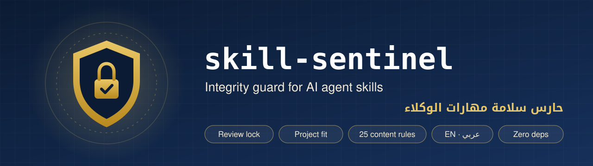
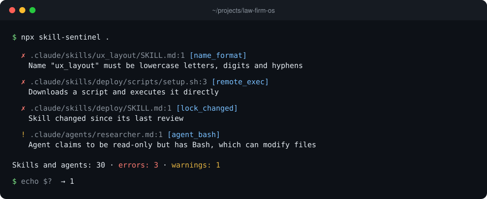
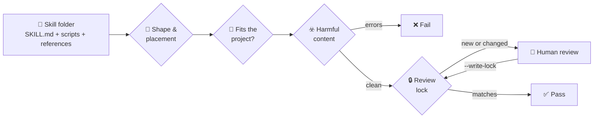

<p align="center">
  
</p>

<p align="center">
  <a href="https://github.com/C3MR/skill-sentinel/actions/workflows/ci.yml"></a>
  
  
  
  <a href="LICENSE"></a>
</p>

<p align="center">
  <b>Scan before you install. Lock after you review. Catch every change after that.</b>
</p>

<p align="center">
  <a href="https://c3mr.github.io/skill-sentinel/">Website</a> ·
  <a href="#-quick-start">Quick start</a> ·
  <a href="#%EF%B8%8F-how-it-works">How it works</a> ·
  <a href="#-the-review-lock">Review lock</a> ·
  <a href="#-github-action">GitHub Action</a> ·
  <a href="docs/rules.md">Rules</a> ·
  <a href="README.ar.md">العربية</a>
</p>

---

## 💡 Why

A skill runs with your agent's full permissions: your shell, your files, your credentials. Installing one means installing instructions your agent will obey.

> **76** confirmed malicious payloads for credential theft, backdoors and data exfiltration, found among **3,984** public skills — and **13.4%** of all skills had at least one critical issue.
> — [Snyk, ToxicSkills](https://snyk.io/blog/toxicskills-malicious-ai-agent-skills-clawhub/)

> Between February and May 2026, **five** malicious skills evaded updated versions of two scanners. No single scanner reliably detects every attack class.
> — [Cloud Security Alliance](https://labs.cloudsecurityalliance.org/research/csa-research-note-ai-agent-skill-scanner-bypass-20260629-csa/)

Scanning once before install is necessary, and not enough. The skill you reviewed last month can change in the next pull request.

## 🛡️ What makes it different

| | Typical skill scanner | **skill-sentinel** |
| :-- | :--: | :--: |
| Harmful-content patterns | ✅ | ✅ English **and Arabic** |
| Catches a skill that changed *after* you reviewed it | ❌ | ✅ **review lock** |
| Shows **which file** changed since the review | ❌ | ✅ |
| Checks hooks, permissions and MCP servers (`settings.json`, `.mcp.json`) | rarely | ✅ |
| Checks frontmatter that pre-approves tools or hides the skill (`allowed-tools`, `user-invocable`) | rarely | ✅ |
| Checks the skill still fits the project (scripts, paths, agent tools) | ❌ | ✅ |
| Refuses to approve a skill that still has errors | — | ✅ |
| Vets a single downloaded skill before install | ✅ | ✅ |
| Messages | English | English · عربي |
| Dependencies | Python, YARA, LLM APIs… | **none** (Node 18+) |
| Published false-positive rate | rarely | ✅ [measured on 9,432 skills](docs/benchmark.md) |

skill-sentinel is built to sit **next to** deeper scanners, not to replace them.

## 🚀 Quick start

```bash
# Vet a skill before you install it
npx skill-sentinel path/to/downloaded-skill --no-lock

# Check a whole project: skills, agents, hooks, permissions and MCP servers
npx skill-sentinel .

# After reviewing every skill, record the lock and commit it
npx skill-sentinel . --write-lock
git add skills.lock.json && git commit -m "skills: reviewed"
```

<p align="center">
  
</p>

<details>
<summary><b>All options</b></summary>

| Option | Effect |
| :-- | :-- |
| `--write-lock` | Record fingerprints after review. Refused while any error remains. |
| `--no-lock` | Skip the lock check, e.g. when vetting a skill before install. |
| `--strict` | Warnings fail too. |
| `--lang en\|ar` | Message language. |
| `--format text\|json\|github` | Output for people, for tools, or as GitHub annotations. |

Exit codes: `0` clean · `1` failing findings · `2` usage error.

</details>

## ⚙️ How it works



Every file in a skill folder is read, not only `SKILL.md`: the script beside it can carry the payload.

The same checks run on what an agent executes without asking: hooks, permission settings and MCP servers.

## 🔒 The review lock

The lock stores a SHA-256 of **every file** in every reviewed skill, agent and security setting in `skills.lock.json`.

1. **Review** the skills — read them, and run the sentinel.
2. **Lock** with `--write-lock`. The sentinel refuses while any error remains: the lock certifies a review, it is not a stamp on anything.
3. **Commit** the lock with the skills.
4. From then on, any **new or changed** skill fails until someone reviews it and refreshes the lock — so a change shows up in review instead of slipping in after trust was granted.

The failure names the exact file, so the reviewer knows where to look:

```
  ✗ .claude/skills/deploy/scripts/run.sh:1 [lock_file_changed]
      File changed since the last review of ".claude/skills/deploy"
  ✗ .claude/skills/deploy/scripts/upload.sh:1 [lock_file_added]
      New file in ".claude/skills/deploy" since its last review
```

For settings files the lock covers only the security keys (`hooks`, `permissions`, MCP servers), so changing a theme does not trigger a review.

> [!IMPORTANT]
> Anyone who can push can also refresh the lock. Protect your main branch and require your review on both:
> ```
> # .github/CODEOWNERS
> skills.lock.json  @your-handle
> .claude/          @your-handle
> ```

## 🤖 GitHub Action

```yaml
name: skills
on: [pull_request]
jobs:
  sentinel:
    runs-on: ubuntu-latest
    steps:
      - uses: actions/checkout@v4
      - uses: C3MR/skill-sentinel@v0
        with:
          path: .
          lang: en      # or ar
          strict: false
```

Findings appear as annotations on the changed lines of the pull request.

## 🧠 As a Claude skill

Copy `skills/skill-sentinel` into `~/.claude/skills/` or your project's `.claude/skills/`. Then ask *"is this skill safe to install?"*

Claude runs the scanner, reads the skill for intent that patterns cannot see, and gives you a verdict: **install**, **install after changes**, or **reject**. It is instructed never to write the lock itself — that decision stays with you.

## 📋 What it checks

<details>
<summary><b>🧾 Shape</b> — is it a well-formed skill?</summary>

Frontmatter present · `name` in lowercase-hyphen form and matching its folder · no reserved words · a `description` of useful length, at most 1024 characters, without XML · a body under 500 lines.

</details>

<details>
<summary><b>📍 Placement</b> — is it where it belongs?</summary>

An optional project prefix · an approved list of external skills · terms forbidden in a location (for example, domain logic inside a shared skill).

</details>

<details>
<summary><b>🧩 Project fit</b> — does it still match the code?</summary>

`npm run` scripts that no longer exist · backticked paths that were deleted (checked from the project root and from the skill's own folder) · agents that claim to be read-only but carry write tools or Bash.

</details>

<details>
<summary><b>🔑 Frontmatter fields</b> — what the skill grants itself</summary>

- **`allowed-tools`** pre-approves tools while the skill is active, so they run without a prompt. Any-shell and network tools (`curl`, `wget`, `ssh`, `WebFetch`…) are flagged.
- **`user-invocable: false`** hides the skill from the slash menu.
- **`model`** lets a skill pick a weaker model to get past refusals, or a costly one.
- **`permissionMode: bypassPermissions`** on an agent fails, and so does a command that starts an agent with `--dangerously-skip-permissions`.
- Every field is scanned for harmful content, including fields the menu never shows, such as `when_to_use`. [HiddenLayer](https://www.hiddenlayer.com/research/whats-the-matter-with-skills) showed these fields used to hide payloads.

</details>

<details>
<summary><b>🪝 Hooks, permissions and MCP</b> — what runs without asking</summary>

From `.claude/settings.json`, `.claude/settings.local.json` and `.mcp.json`:

- **Hooks.** Every hook command, and the local script it calls, is checked with all the harmful-content rules. A hook that calls the network is flagged.
- **Permissions.** A `bypassPermissions` mode fails. An allow rule for any Bash command is flagged.
- **MCP servers.** Flags a server started with `npx`/`uvx` without a pinned version, a server reached over plain http, and every project server enabled automatically. A secret written into the config fails.

</details>

<details>
<summary><b>☣️ Harmful content</b> — 25 rules</summary>

Instruction override and system impersonation (English and Arabic) · hiding things from the user · invisible and direction-overriding Unicode · recursive deletes · force push · disabling row level security · skipping git hooks · download-and-execute · sending secrets over the network · credential paths · shortened URLs · hard-coded API keys, private keys and JWTs · long base64 blocks.

A match inside quotes, after "tries to", or after a negation ("never run…") is reported as a **warning with a note**, because documentation describes attacks too. A match inside an HTML comment stays an **error**, because comments hide text from human readers.

</details>

The full list, with every message in both languages: **[docs/rules.md](docs/rules.md)**.

## 🧩 Policy

Optional `.skills-policy.json` at the project root:

```json
{
  "prefix": "acme-",
  "external": ["supabase"],
  "forbiddenTerms": [],
  "allowRules": []
}
```

For one legitimate line, add `guard-allow: <reason>` to it. A reason of at least five characters is required.

## 📊 Measured, not claimed

Run on three public collections at fixed commits ([full method and classification](docs/benchmark.md)):

| Collection | Skills | Errors | Time |
| :-- | --: | --: | --: |
| anthropics/skills | 20 | 2 — both real spec issues | 0.7 s |
| obra/superpowers | 15 | 0 | 0.1 s |
| antigravity-awesome-skills | 9,397 | 54 unique — 42 security reference material, 7 true, **5 false** | 29 s |

False errors touched **4 of 9,432 skills (~0.04%)**. Warnings were not precision-measured.

## ⚠️ Limits

This is pattern matching plus a lock, **not proof of safety**. A new phrasing can pass any pattern list — which is exactly why the lock exists: whatever the patterns miss, a changed skill still waits for a human. Read the skills you install.

## 🗺️ Roadmap

- [x] Show which files changed since the last review, not only which skill
- [x] Scan hooks, permissions and MCP server configuration
- [x] Measured false-positive rate on public skill collections
- [ ] Vet a skill straight from a GitHub URL before cloning it
- [ ] SARIF output for GitHub code scanning
- [ ] Record each skill's source and commit in the lock
- [ ] Precision measurement for warnings

## 🛠️ Development

```bash
npm test            # 85 tests on node:test, no dependencies
npm run scan        # the sentinel checks itself
npm run rules:docs  # regenerate docs/rules.md from the code
```

New rules come with tests for what they flag **and** what they leave alone.

## 🔐 Security

Found a skill that should fail but passes, or a way around the lock? Report it privately — see [SECURITY.md](SECURITY.md).

## 📄 License

[MIT](LICENSE) © [Omer Haidr](https://c3mr.me)
